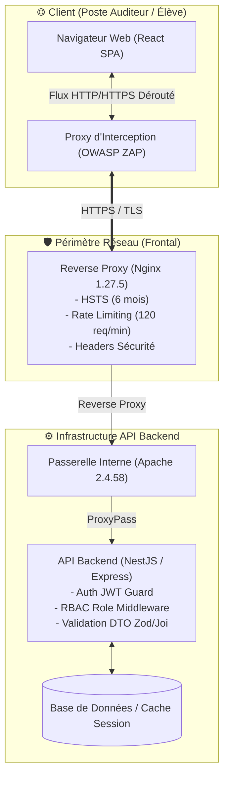
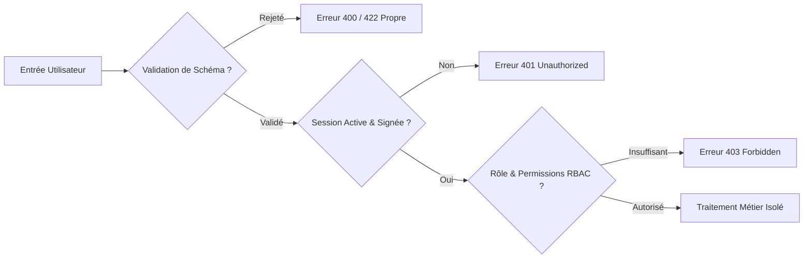

# 🛡️ Fullstack Application Security (AppSec) & Pentest Audit Framework

<div align="center">

[](https://owasp.org)
[]()
[]()
[]()

**Référentiel méthodologique professionnel d'audit de sécurité applicatif, de tests d'intrusion boîte grise (DAST) et de validation de recette pré-production.**

[Explorer les Rapports](#-structure-du-dépôt--livrables) • [Méthodologie](#-méthodologie-daudit-en-5-phases) • [Résultats Validés](#-résultats-techniques--preuves-daudit) • [À Propos](#-auteur)

</div>

---

## 📌 Contexte & Objectifs de l'Évaluation

Ce projet documente la démarche rigoureuse d'un audit de sécurité applicatif complet (**AppSec / Pentest boîte grise**) réalisé sur une plateforme web moderne avant son déploiement en production.

L'application auditée est composée d'un frontend Single Page Application (React) communiquant avec une API REST (NestJS / Node.js) abritée derrière une passerelle de Reverse Proxy (Nginx / Apache).

> 🎯 **Objectif technique :** Démontrer par des tests techniques réels que l'application respecte les principes de **Security by Design**, de **Défense en Profondeur** et de **Moindre Privilège**, en neutralisant les risques majeurs du standard mondial **OWASP Top 10**.

---

## 🏗️ Architecture Technique & Surface d'Attaque

Voici le schéma architectural complet découvert et analysé lors de l'audit via le proxy d'interception :



---

## 🧠 Le Modèle Mental d'Audit (Cycle de la Donnée)

Un auditeur sécurité ne se contente pas d'injecter des charges utiles au hasard. Il analyse la trajectoire exacte de chaque flux :



---

## 📊 Résultats Techniques & Preuves d'Audit

Chaque contrôle de sécurité a fait l'objet d'un test technique instrumenté. Voici la matrice de conformité validée :

| Domaine OWASP | Contrôle Testé | Vecteur de Test | Comportement Observé | Statut |
|---|---|---|---|:---:|
| **A01 Broken Access** | **Cloisonnement RBAC** | Appel de `/api/admin/users` avec un token `student` | Rejet strict : `{"statusCode":403,"code":"FORBIDDEN"}` | ✅ **100% Hermétique** |
| **A01 Broken Access** | **Prévention IDOR / BOLA** | Manipulation d'IDs arbitraires `/api/courses/00...` | Réponse propre `404 Not Found` (aucun crash 500) | ✅ **Conforme** |
| **A07 Authentication** | **Révocation de Session** | Rejeu du JWT après clic sur « Déconnexion » | Rejet immédiat : `401 Unauthorized` (Token Blacklisté) | ✅ **Excellent** |
| **A07 Authentication** | **Protection Sans Session** | Appel de `/api/independent/me` sans token | Rejet immédiat : `401 Unauthorized` | ✅ **Conforme** |
| **A04 Insecure Design** | **Intégrité des Quiz** | Soumission `POST /api/quizzes/{id}/submit` | Client n'envoie que ses choix bruts ; calcul serveur | ✅ **Inviolable Client** |
| **A05 Misconfiguration** | **Protection Anti-DDoS** | Cadence de requêtes sur l'API | En-têtes actifs : `X-RateLimit-Limit: 120` | ✅ **Robuste** |
| **A05 Misconfiguration** | **Exposition de Fichiers** | Requêtes sur `/.env`, `/.git`, `/robots.txt` | Redirection SPA vers `index.html` (pas de fuite) | ✅ **Conforme** |
| **A02 Crypto Failures** | **Transport Sécurisé** | En-têtes HTTP de réponse | `Strict-Transport-Security: max-age=15768000` (HSTS) | ✅ **Conforme** |
| **A05 Misconfiguration** | **Anti-Clickjacking** | Intégration en `<iframe>` | `X-Frame-Options: SAMEORIGIN` actif | ✅ **Conforme** |

---

## 🔬 Focus sur les Preuves d'Audit Clés

### 1. Invalidation Immédiate de Session (Révocation JWT Active)
La plupart des applications effacent simplement le token dans le navigateur (vulnérable au rejeu). Ici, le serveur blackliste activement le jeton dès la déconnexion :
```http
GET /api/independent/me HTTP/1.1
Authorization: Bearer <token_apres_deconnexion>

HTTP/1.1 401 Unauthorized
{"statusCode":401,"code":"UNAUTHORIZED","message":"Jeton d'accès invalide ou expiré."}
```

### 2. Étanchéité Absolue du Contrôle de Rôle (RBAC)
Même forgée directement via le proxy en contournant totalement l'interface utilisateur, une requête privilégiée est immédiatement bloquée par le middleware backend :
```http
GET /api/admin/users HTTP/1.1
Authorization: Bearer <token_eleve_actif>

HTTP/1.1 403 Forbidden
{"statusCode":403,"code":"FORBIDDEN","message":"Vous n'avez pas les droits nécessaires pour cette action."}
```

### 3. Logique Métier Zero-Trust (Évaluations & Notes)
Le client n'a aucun pouvoir sur le score : il transmet uniquement la liste de ses sélections. Le barème et le calcul restent confinés au secret du serveur :
```json
POST /api/quizzes/6ac12d.../submit
{
  "answers": [
    {"questionId": "6ac12...", "selected": []}
  ]
}
```

---

## 🗂️ Structure du Dépôt & Livrables

Ce dépôt est structuré de façon modulaire pour permettre une traçabilité totale :

```text
├── 📑 GRAND_RAPPORT_AUDIT_FINAL.md           # Rapport de synthèse d'audit pré-production
├── 🚀 checklist_pre_lancement_eleves.md       # Recette opérationnelle de déploiement
├── 🛡️ skill.md                               # Référentiel méthodologique et modèle mental
├── 📋 identifant.md                          # Grille de vérification des 20 points
├── ⚙️ owasp_zap.md / etape0_installation_zap.md # Guides complets de configuration ZAP
├── 🛠️ panorama_outils_securite.md             # Analyse comparative (DAST vs SAST)
└── 🔬 etape1_*.md à etape18_*.md              # 18 rapports unitaires avec requêtes brutes
```

---

## 💡 Domaines d'Expertise & Standards Couverts

* **Application Security (AppSec) :** Maîtrise des concepts OWASP Top 10, CWE et stratégies de défense en profondeur.
* **Sécurité des APIs & JWT :** Conception de flux d'authentification sans état, gestion de durée courte, mécanismes de révocation active.
* **Sécurité Backend & Middleware :** Implémentation de RBAC, validation de schémas stricts, limitation de débit (Rate Limiting).
* **Outillage Professionnel :** Utilisation avancée d'OWASP ZAP (interception, analyse passive, renvoi de requêtes), notions de Burp Suite et Semgrep.
* **Documentation & Reporting :** Production de rapports d'évaluation clairs, documentés avec preuves techniques et matrices de remédiation.

---

## 👤 Auteur

**Papa Malick TEUW**  
*Développeur Fullstack, Développeur IA & Praticien Sécurité Applicative (AppSec)*  
* 💼 GitHub : [@MalickDevWeb](https://github.com/MalickDevWeb)  
* 📧 Email : [malickteuw.devweb@gmail.com](mailto:malickteuw.devweb@gmail.com)
