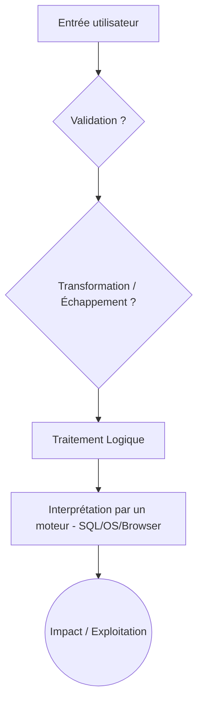

# 🛡️ Audit de Code & Pentest Applicatif

Ce skill est un guide de référence et d'apprentissage pour maîtriser l'audit de sécurité d'une application (code source) et le test d'intrusion (pentest) web et API.

La sécurité n'est jamais absolue ("100% sûr" n'existe pas). L'objectif d'un audit est de réduire systématiquement la surface d'attaque, d'augmenter fortement la confiance dans l'application, et de s'assurer que des contrôles de sécurité critiques sont en place.

---

## 🎯 1. Les Compétences Clés (OWASP Top 10)

Avant d'utiliser des outils automatisés, il est indispensable de maîtriser théoriquement et pratiquement les vulnérabilités web majeures (OWASP Top 10) :

| Vulnérabilité | Ce que vous apprenez à détecter |
|---|---|
| **A01 Broken Access Control** | Contournements d'autorisations, IDOR/BOLA (ex: l'utilisateur A accède aux données de B). |
| **A02 Cryptographic Failures** | Mauvaise gestion des secrets, mots de passe non hachés, chiffrement faible. |
| **A03 Injection** | Entrées utilisateur manipulant des requêtes (SQLi, NoSQLi, Command Injection, XSS). |
| **A04 Insecure Design** | Failles de conception, logique métier faillible. |
| **A05 Security Misconfig** | Mauvaises configurations serveurs, headers manquants, messages d'erreur verbeux. |
| **A06 Vulnerable Components** | Dépendances obsolètes ou vulnérables (`npm audit`, `composer audit`). |
| **A07 Authentication Failures** | Contournement de la connexion, gestion faible des sessions (JWT, cookies). |
| **A08 Integrity Failures** | Fichiers malveillants uploadés (File Upload), CI/CD non sécurisée. |
| **A09 Logging & Monitoring** | Manque de traçabilité, ou à l'inverse, fuite de données sensibles dans les logs. |
| **A10 SSRF** | Faire effectuer des requêtes internes par votre propre serveur. |

---

## 🧠 2. Le Modèle Mental du Pentester

La logique d'un auditeur/pentester ne se limite pas à : *"Je lance une payload et je regarde si ça marche."*
Un véritable professionnel suit le cycle de la donnée :

### Questions systématiques à se poser lors d'une revue de code :
1. D'où vient cette donnée ? (Est-ce contrôlé par l'utilisateur ?)
2. Est-elle validée stricto sensu (whitelist) ?
3. Arrive-t-elle dans une requête SQL, une commande OS, ou renvoyée dans le HTML ?
4. L'utilisateur peut-il modifier un identifiant (ID) ? L'API vérifie-t-elle ses permissions pour *cet* ID précis (IDOR) ?

---

## 🏗️ 3. Méthodologie d'Audit (Le Processus en 13 Étapes)

Pour votre application, voici la démarche méthodique à appliquer sur un environnement de **Staging** (et non en production directe) :

1. **Reconnaissance :** Technologies, endpoints, ports, headers HTTP, flux d'authentification.
2. **Surface d'attaque :** Cartographie de tous les points d'entrée de l'application (formulaires, API, uploads).
3. **Secrets / Credentials :** Recherche de clés exposées dans le code, Git ou Docker.
4. **Authentication :** Tests de robustesse de la connexion, JWT, cookies de session.
5. **Authorization (IDOR/BOLA) :** Le compte A peut-il faire une action du compte B ? L'utilisateur standard peut-il devenir Admin ?
6. **Injections :** SQLi, XSS, Command Injection, Path Traversal.
7. **Sécurité de l'API :** Rate limiting, CORS, CSRF, GraphQL/REST abuse.
8. **Database :** Sécurisation de l'accès réseau (ex: ne pas exposer le port 3306/5432 sur Internet).
9. **Docker / Serveur :** Mauvaises configurations système, conteneurs tournant en `root`.
10. **Dépendances :** Scan SAST et vérification des paquets tiers.
11. **Logs / Monitoring :** Vérification des fuites d'informations dans les fichiers de logs.
12. **Correction :** Implémentation des correctifs (ex: requêtes paramétrées).
13. **Retest :** Vérification que la faille est bien corrigée.

---

## 🔑 4. La Chasse aux Secrets Exposés

Il n'existe pas de méthode "100% sûre", mais vous devez absolument traquer les fuites de credentials.

### 4.1. Dans le code source et le dépôt Git
Une erreur classique est de commiter un `.env`, puis de le supprimer. **Le secret reste dans l'historique Git.**
- **Fichiers cibles :** `.env.*`, `docker-compose.yml`, `*.pem`, `*.key`, `*.json` (comptes de service).
- **Mots clés :** `DATABASE_URL`, `API_KEY`, `JWT_SECRET`, `AWS_SECRET_ACCESS_KEY`.
- **Outils :** `gitleaks detect`, `trufflehog`.

### 4.2. Dans le Frontend (React, Vue, Angular)
Tout ce qui est envoyé au navigateur est public.
- Inspectez les bundles JS, les requêtes réseau et le `localStorage`.
- `const API_KEY = "ma-cle";` dans une application React est une faille critique si c'est une clé privée.

### 4.3. Dans les réponses de l'API
Assurez-vous que l'API ne renvoie pas plus de données que nécessaire (ex: renvoyer le `password_hash` ou des `internal_tokens` lors d'un `GET /api/users/me`).

### 4.4. Dans Docker et les Logs
- Ne pas passer les secrets en clair via des variables d'environnement non sécurisées.
- Ne jamais logger des objets complets de type requête (ex: `Log::error($request)`), cela pourrait enregistrer des mots de passe ou des tokens JWT en clair.

---

## 🛠️ 5. La Stack Outils du Pentester / Auditeur

L'outillage automatise la détection, mais la validation est humaine.

### Analyse de Code (SAST)
- **Semgrep / SonarQube / Snyk / GitHub CodeQL**
- **Spécifiques :** PHPStan (Laravel), ESLint (JS/TS), Bandit (Python)

### Pentest Web et API (DAST)
- **Proxies & Scanners :** Burp Suite, OWASP ZAP
- **Réseau & Fuzzing :** Nmap, ffuf, Nikto, Postman (pour structurer les tests API)

### Scan de Dépendances (SCA)
- `composer audit`, `npm audit`, `pip-audit`

---

## 📁 6. Index des Rapports Pratiques Réalisés

Voici l'ensemble des études de cas réelles et documentations associées créées sur ce projet :

* 📑 **[GRAND_RAPPORT_AUDIT_FINAL.md](file:///c:/aplication/GRAND_RAPPORT_AUDIT_FINAL.md)** : Rapport complet de recette sécurité pré-lancement.
* 📋 **[identifant.md](file:///c:/aplication/identifant.md)** : Feuille de route en 20 points (état d'avancement).
* ⚙️ **[owasp_zap.md](file:///c:/aplication/owasp_zap.md)** & **[etape0_installation_zap.md](file:///c:/aplication/etape0_installation_zap.md)** : Guide d'installation et maîtrise d'OWASP ZAP.
* 🗺️ **[etape1_reconnaissance_cartographie.md](file:///c:/aplication/etape1_reconnaissance_cartographie.md)** : Endpoints réels découverts.
* 🔑 **[etape2_analyse_jwt.md](file:///c:/aplication/etape2_analyse_jwt.md)** & **[etape8_revocation_session_deconnexion.md](file:///c:/aplication/etape8_revocation_session_deconnexion.md)** : Audit et révocation des sessions JWT.
* 🛡️ **[etape12_validation_rbac_403_admin.md](file:///c:/aplication/etape12_validation_rbac_403_admin.md)** : Validation du contrôle d'accès RBAC (403 Forbidden).
* 🎯 **[etape18_validation_logique_metier_quiz.md](file:///c:/aplication/etape18_validation_logique_metier_quiz.md)** : Intégrité de la notation côté serveur.
* 🚀 **[checklist_pre_lancement_eleves.md](file:///c:/aplication/checklist_pre_lancement_eleves.md)** : Contrôles opérationnels de mise en production.

---

## 🚀 7. Conclusion et Objectif
L'objectif final de cette discipline n'est pas de se demander *"Comment pirater ma base de données ?"*, mais d'adopter l'approche d'un ingénieur sécurité :

> *"Quelle est la chaîne d'attaque qui permettrait à un attaquant d'atteindre cette donnée critique, et comment puis-je briser cette chaîne par une défense en profondeur ?"*

Ne devenez pas un simple utilisateur d'outils. Lisez le code, comprenez les mécanismes sous-jacents de la stack (Node/NestJS, React) et sachez expliquer la vulnérabilité de manière conceptuelle avant même de la tester.